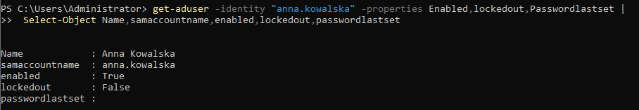
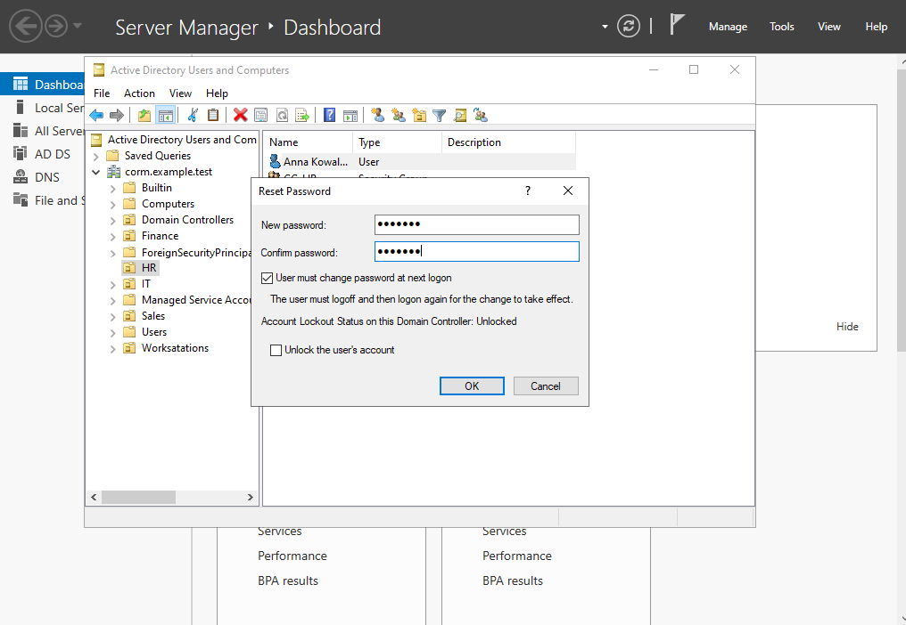
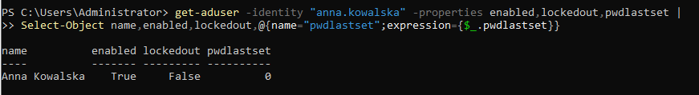
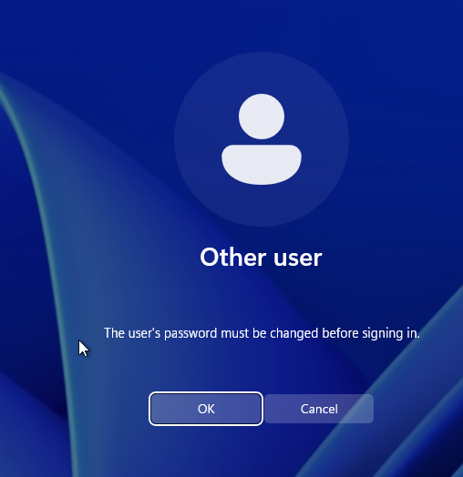
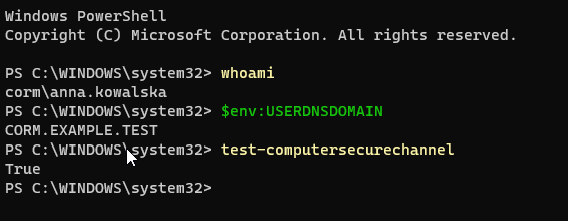
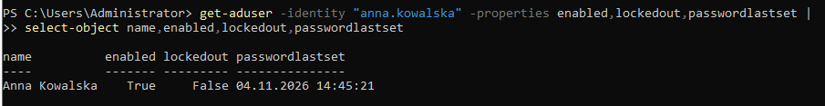

# HD-001 — Active Directory Password Reset

**Project:** Corporate IT Support Home Lab  
**Ticket ID:** HD-001  
**Category:** Service Request — Identity & Access Management  
**Priority:** P3 — Normal (Lab Classification)  
**Status:** Resolved  
**Environment:** Windows Server 2022 / Windows 11 Enterprise / Active Directory Domain Services

---

## 1. Ticket Overview

**Issue:** User unable to sign in due to a forgotten password.

**Scenario:** An employee from the Human Resources department returned from vacation and reported that they could no longer remember their domain account password.

**Affected account:** `anna.kowalska`  
**Department:** Human Resources  
**Domain:** `corp.example.test`

**Objective:** Restore the employee's access by resetting the Active Directory password, enforcing a password change at the next logon, and validating domain authentication.

*This scenario was performed in an isolated home lab using fictional employee accounts. Identity verification was simulated.*

## 2. Lab Environment

| Component | Configuration |
|---|---|
| Domain Controller | DC01 |
| Server OS | Windows Server 2022 |
| Client Workstation | CLIENT01 |
| Client OS | Windows 11 Enterprise |
| Active Directory Domain | corp.example.test |
| NetBIOS Domain | CORM |
| Domain Controller IP | 10.20.30.10 |
| Client IP | 10.20.30.101 |
| Virtualization | Oracle VirtualBox |

**Tools used:**
- Active Directory Users and Computers (ADUC)
- Windows PowerShell
- Active Directory PowerShell Module
- Windows 11 Domain Login

## 3. Initial Account Assessment

The investigation began by checking the user's Active Directory account status through PowerShell.

```powershell
Get-ADUser -Identity "anna.kowalska" -Properties Enabled,LockedOut,PasswordLastSet |
Select-Object Name,SamAccountName,Enabled,LockedOut,PasswordLastSet
```

The command was used to inspect account availability, lockout status, and the timestamp of the previous password change.

This assessment helps distinguish a forgotten password from a disabled or locked account.

**Evidence:**



## 4. Password Reset Procedure

The password reset was performed using Active Directory Users and Computers.

**Procedure:**

1. Opened Active Directory Users and Computers on DC01.
2. Navigated to `corp.example.test → Company → HR`.
3. Located the account `anna.kowalska`.
4. Selected **Reset Password**.
5. Assigned a temporary password.
6. Enabled **User must change password at next logon**.
7. Confirmed the password reset.

The forced password change ensures that the temporary password is replaced with a password chosen by the user.

No passwords or authentication secrets are included in this repository.

**Evidence:**



## 5. Post-Reset Verification

The account was inspected again using PowerShell:

```powershell
Get-ADUser -Identity "anna.kowalska" -Properties Enabled,LockedOut,pwdLastSet |
Select-Object Name,Enabled,LockedOut,@{Name="pwdLastSet";Expression={$_.pwdLastSet}}
```

The `pwdLastSet` attribute was checked to verify that a password change was required at the next logon.

A value of `0` indicates that the account must change its password during the next successful sign-in.

**Evidence:**



## 6. Client-Side Authentication Test

The authentication process was tested on CLIENT01 using the domain account:

`CORM\anna.kowalska`

The user was prompted to change the temporary password before completing sign-in.

After setting a new password, the account was used to sign in to Windows 11.

**Evidence:**



### Domain Authentication Validation

The following commands were executed on CLIENT01:

```powershell
whoami
```

```powershell
$env:USERDNSDOMAIN
```

```powershell
Test-ComputerSecureChannel
```

These commands were used to verify:

- The identity of the signed-in domain user.
- Membership in the expected Active Directory domain.
- The workstation's secure channel with the domain.

**Evidence:**



## 7. Final Account Validation

After the client-side password change, the account was checked again on DC01.

```powershell
Get-ADUser -Identity "anna.kowalska" -Properties Enabled,LockedOut,PasswordLastSet |
Select-Object Name,Enabled,LockedOut,PasswordLastSet
```

The final verification covered the account's enabled status, lockout status, and updated password timestamp.

**Evidence:**



## 8. Resolution Summary

**Resolution:** The account password was reset through ADUC, and the user was required to replace the temporary password during the next logon.

**Validation:** Successful Windows domain sign-in, domain identity verification, and final Active Directory account inspection.

**Ticket Status:** Resolved.

## 9. Security Considerations

Several important security practices were incorporated into the exercise:

- Identity verification should precede password resets in production environments.
- Temporary passwords must be communicated through approved secure channels.
- Password changes should be enforced after administrative resets.
- Account lockout and disabled-account conditions should be checked before proceeding.
- Administrative permissions should be used only for authorized support activities.
- Passwords and sensitive credentials must never be committed to GitHub.

## 10. Skills Demonstrated

- Active Directory account administration
- Password reset procedures using ADUC
- PowerShell-based account assessment
- Domain authentication troubleshooting
- User account status validation
- Basic Identity and Access Management (IAM)
- Helpdesk ticket resolution and technical documentation

## 11. Lessons Learned

This exercise demonstrated how a standard Helpdesk password reset involves more than simply assigning a new password.

An effective support workflow includes initial account assessment, appropriate authorization, secure credential handling, user-side validation, and final confirmation that access has been restored.

It also highlighted the importance of understanding Active Directory account attributes such as `Enabled`, `LockedOut`, `PasswordLastSet`, and `pwdLastSet`.

---

**Lab Type:** Personal IT Support Training Environment  
**Scope:** Authorized, isolated Active Directory home lab  
**Purpose:** Practical preparation for IT Support / Helpdesk and Junior System Administrator roles
