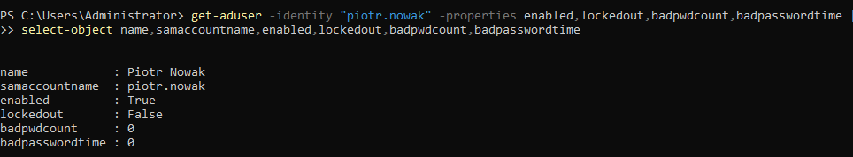
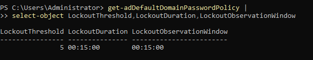
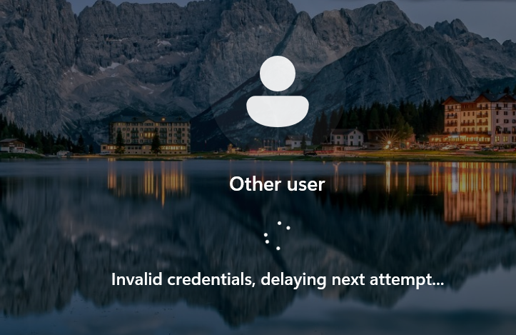
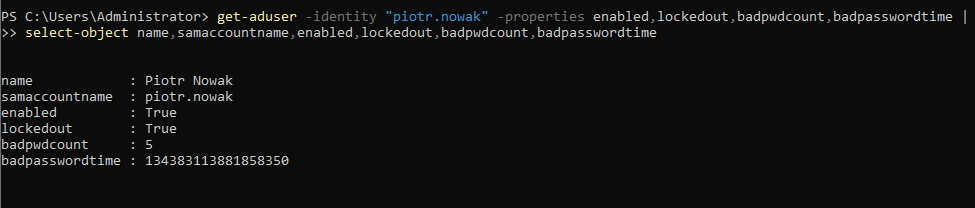
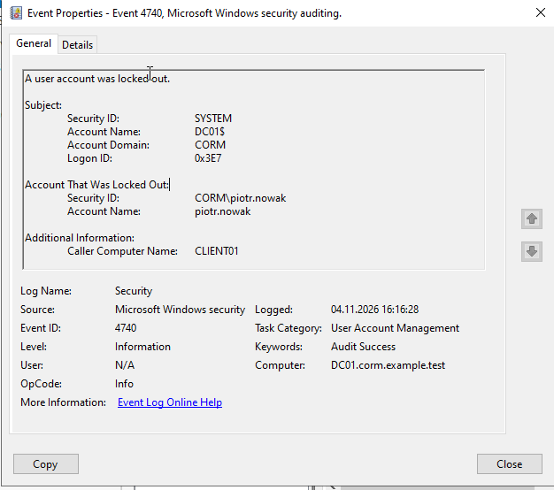
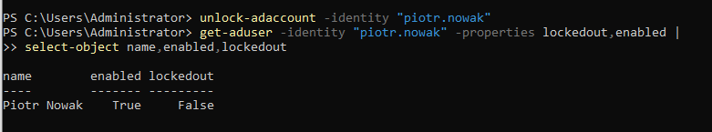
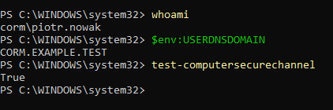

# HD-002 — Active Directory Account Lockout Investigation

**Project:** Corporate IT Support Home Lab  
**Ticket ID:** HD-002  
**Category:** Incident — Identity & Access Management  
**Priority:** P3 — Normal (Lab Classification)  
**Status:** Resolved  
**Environment:** Windows Server 2022 / Windows 11 Enterprise / Active Directory Domain Services

---

## 1. Incident Overview

**Issue:** User unable to sign in due to an Active Directory account lockout.

**Scenario:** An employee from the Finance department reported being unable to access their Windows account after entering an incorrect password multiple times.

**Affected account:** `piotr.nowak`  
**Department:** Finance  
**Domain:** `corp.example.test`

**Objective:** Investigate the account lockout, identify the cause of failed authentication attempts, restore account access, and verify successful domain authentication.

*This incident was simulated in an isolated Active Directory home lab using fictional employee accounts.*

## 2. Lab Environment

| Component | Configuration |
|---|---|
| Domain Controller | DC01 |
| Server OS | Windows Server 2022 |
| Client Workstation | CLIENT01 |
| Client OS | Windows 11 Enterprise |
| Active Directory Domain | corp.example.test |
| NetBIOS Domain | CORM |
| Domain Controller IP | 10.20.XX.XX |
| Client IP | 10.20.XX.XX |
| Virtualization | Oracle VirtualBox |

**Tools Used:**
- Active Directory Users and Computers (ADUC)
- Windows PowerShell
- Active Directory PowerShell Module
- Group Policy Management
- Windows Event Viewer
- Windows 11 Domain Authentication

## 3. Initial Account Assessment

The investigation began by checking the affected user's Active Directory account status.

The following PowerShell command was used:

```powershell
Get-ADUser -Identity "piotr.nowak" -Properties Enabled,LockedOut,badPwdCount,badPasswordTime |
Select-Object Name,SamAccountName,Enabled,LockedOut,badPwdCount,badPasswordTime
```

The assessment focused on:

- `Enabled` — whether the account was active.
- `LockedOut` — whether the account was locked.
- `badPwdCount` — the recorded number of failed password attempts.
- `badPasswordTime` — the timestamp of the last recorded failed password attempt.

These attributes help distinguish an account lockout from other authentication issues.

**Evidence:**



## 4. Account Lockout Policy Verification

The domain account lockout policy was inspected using PowerShell:

```powershell
Get-ADDefaultDomainPasswordPolicy |
Select-Object LockoutThreshold,LockoutDuration,LockoutObservationWindow
```

The lab scenario used the following policy configuration:

| Setting | Value |
|---|---|
| Account Lockout Threshold | 5 invalid attempts |
| Account Lockout Duration | 15 minutes |
| Reset Lockout Counter After | 15 minutes |

These settings define when an account becomes locked and when the lockout counter resets.

**Evidence:**



## 5. Incident Reproduction

To reproduce the reported incident, multiple unsuccessful authentication attempts were performed on CLIENT01.

**Procedure:**

1. Opened the Windows 11 sign-in screen.
2. Selected the domain account `CORM\piotr.nowak`.
3. Entered an incorrect password repeatedly.
4. Triggered the configured account lockout policy.
5. Observed the Windows account lockout notification.

This controlled simulation demonstrated how Active Directory responds to repeated failed authentication attempts.

**Evidence:**



## 6. Account Lockout Verification

After reproducing the issue, the account status was checked again on DC01.

```powershell
Get-ADUser -Identity "piotr.nowak" -Properties Enabled,LockedOut,badPwdCount,badPasswordTime |
Select-Object Name,Enabled,LockedOut,badPwdCount,badPasswordTime
```

The verification focused on the account lockout state and authentication failure attributes.

Because failed password counters can be maintained separately by domain controllers, their values must be interpreted in the context of the environment.

**Evidence:**



## 7. Security Event Investigation

Windows Event Viewer was used to investigate the account lockout.

**Location:**

`Event Viewer → Windows Logs → Security`

The investigation focused on:

**Event ID 4740 — A user account was locked out**

The event provides information that can help identify the affected account and the origin of the lockout.

Relevant fields include:

- Event ID
- Timestamp
- Target Account Name
- Account Domain
- Caller Computer Name

The following PowerShell command was also used to search for lockout events:

```powershell
Get-WinEvent -FilterHashtable @{
    LogName = 'Security'
    Id = 4740
    StartTime = (Get-Date).AddHours(-2)
} | Select-Object TimeCreated, Id, Message
```

The purpose of this investigation was to correlate the account lockout with unsuccessful authentication attempts in the laboratory environment.

**Evidence:**



## 8. Account Unlock Procedure

After investigating the simulated lockout, the affected account was unlocked using PowerShell.

```powershell
Unlock-ADAccount -Identity "piotr.nowak"
```

The account state was verified with:

```powershell
Get-ADUser -Identity "piotr.nowak" -Properties LockedOut,Enabled |
Select-Object Name,Enabled,LockedOut
```

The verification confirmed that the account was enabled and no longer marked as locked.

**Evidence:**



## 9. Client-Side Authentication Validation

After unlocking the account, domain authentication was tested on CLIENT01.

**Account:** `CORM\piotr.nowak`

The following PowerShell commands were executed after signing in:

```powershell
whoami
```

```powershell
$env:USERDNSDOMAIN
```

```powershell
Test-ComputerSecureChannel
```

These commands were used to validate:

- The signed-in domain identity.
- The Active Directory domain associated with the session.
- The workstation's secure channel with the domain controller.

**Evidence:**



## 10. Root Cause Analysis

**Symptom:** The user could not authenticate to their domain account.

**Technical Cause:** The account was locked after repeated unsuccessful authentication attempts exceeded the configured account lockout threshold.

**Root Cause:** Incorrect credentials were intentionally entered during a controlled simulation on CLIENT01.

**Resolution:** The account was unlocked using Active Directory PowerShell administration tools.

**Validation:** Domain authentication was tested again after the account was unlocked.

## 11. Security Considerations

This exercise demonstrated several important security principles:

- Account lockout policies help mitigate repeated password-guessing attempts.
- User identity should be verified before administrative account recovery.
- Account lockouts should be investigated before being cleared.
- Event ID 4740 can provide useful evidence during authentication incident investigations.
- Repeated lockouts may indicate outdated stored credentials, misconfigured services, or potentially unauthorized activity.
- Administrative privileges should be limited to authorized support operations.
- Authentication logs should be reviewed when investigating recurring account lockouts.

## 12. Skills Demonstrated

- Active Directory account administration
- Account lockout policy verification
- Windows domain authentication troubleshooting
- PowerShell-based incident investigation
- Windows Security Event Log analysis
- Account lockout recovery
- Identity and Access Management (IAM)
- Helpdesk incident documentation
- Root cause analysis

## 13. Lessons Learned

This exercise demonstrated that resolving an account lockout involves more than unlocking the affected user.

A structured troubleshooting process requires checking account status, understanding domain lockout policies, reviewing relevant authentication events, and verifying that access has been restored.

The investigation also highlighted the importance of distinguishing between the immediate technical issue and the underlying cause.

In production environments, repeated account lockouts may require further investigation before account access is restored.

---

**Lab Type:** Personal IT Support Training Environment  
**Scope:** Authorized, isolated Active Directory Home Lab  
**Purpose:** Practical preparation for IT Support, Helpdesk, and Junior System Administrator roles
