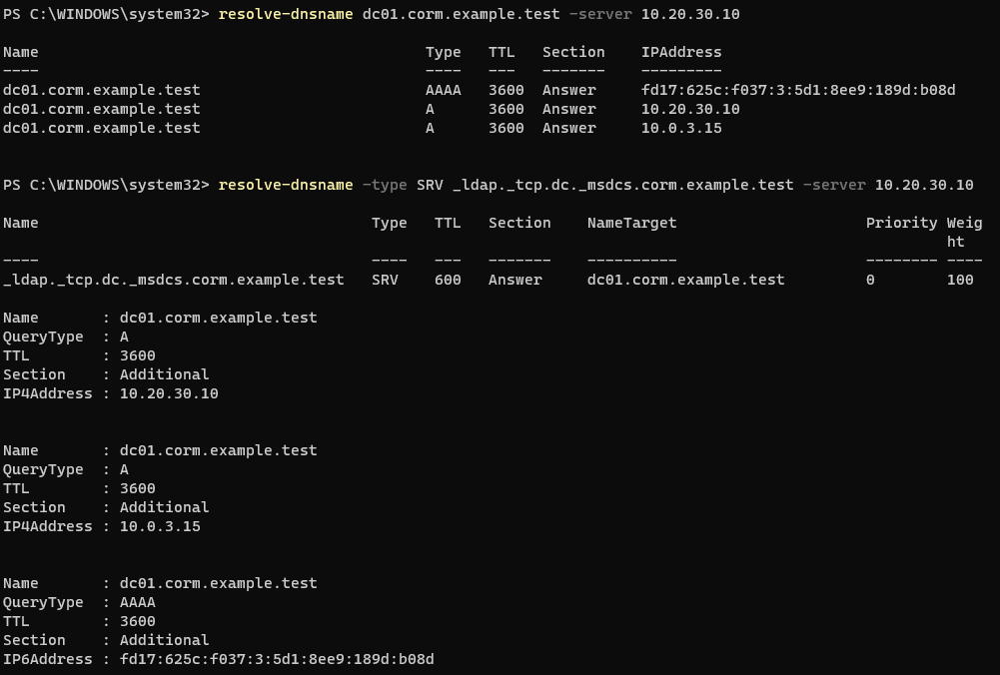
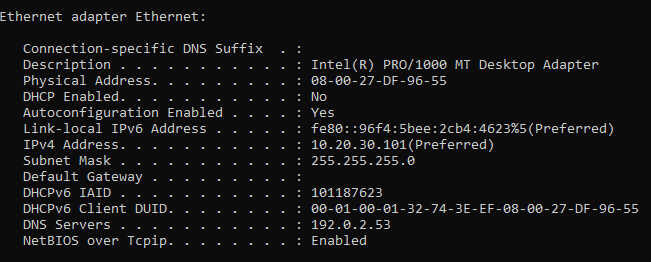
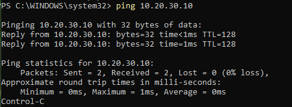
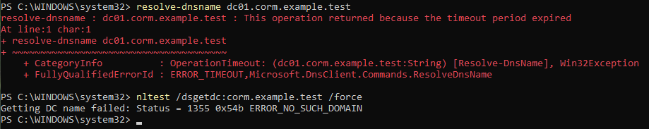
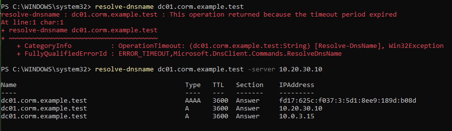
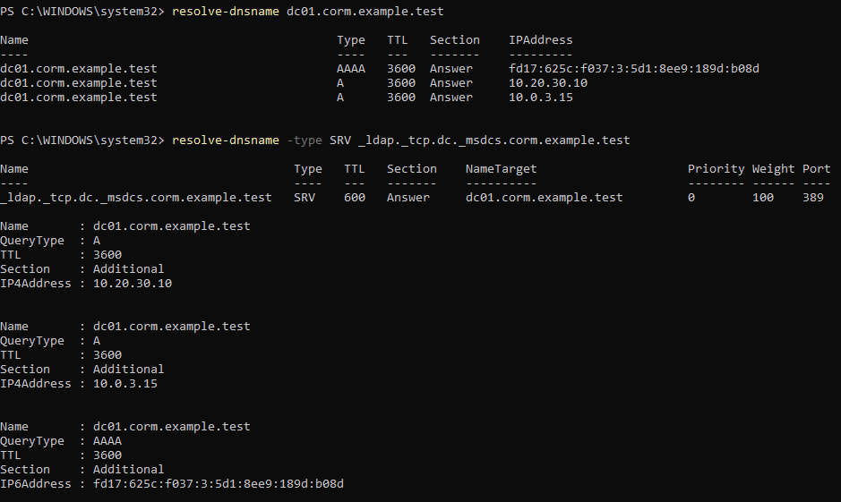
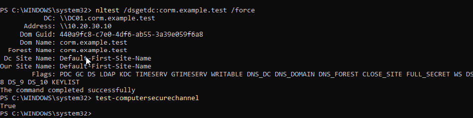
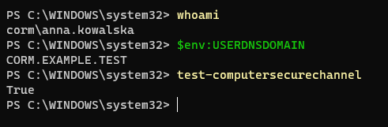

# HD-003 — Active Directory DNS Troubleshooting

**Project:** Corporate IT Support Home Lab  
**Ticket ID:** HD-003  
**Category:** Incident — Network & Domain Connectivity  
**Priority:** P2 — High (Lab Classification)  
**Status:** Resolved  
**Environment:** Windows Server 2022 / Windows 11 Enterprise / Active Directory Domain Services

---

## 1. Incident Overview

**Issue:** Windows workstation experiencing Active Directory domain discovery and DNS resolution problems.

**Scenario:** An employee from the Sales department reported difficulties accessing domain-related resources. The incident was reproduced by intentionally configuring an incorrect DNS server on the workstation.

**Affected user:** `ewa.wisniewska`  
**Department:** Sales  
**Affected workstation:** `CLIENT01`  
**Domain:** `corp.example.test`

**Objective:** Identify the cause of the DNS resolution failure, verify network connectivity, restore the correct DNS configuration, and validate communication with Active Directory.

*This incident was simulated in an isolated home lab using fictional employee accounts.*

## 2. Lab Environment

| Component | Configuration |
|---|---|
| Domain Controller | DC01 |
| Server OS | Windows Server 2022 |
| Client Workstation | CLIENT01 |
| Client OS | Windows 11 Enterprise |
| Active Directory Domain | corp.example.test |
| NetBIOS Domain | CORM |
| Domain Controller IP | 10.20.XX.XX |
| Client IP | 10.20.XX.XX |
| Internal Network | IT_SUPPORT_LAN |
| Virtualization | Oracle VirtualBox |

**Tools Used:**
- Windows PowerShell
- Windows TCP/IP Networking Tools
- Resolve-DnsName
- ipconfig
- ping
- Test-NetConnection
- nltest
- Test-ComputerSecureChannel

## 3. Initial DNS Configuration Assessment

The investigation began by examining the workstation's network configuration and verifying its DNS settings.

The following PowerShell commands were used:

```powershell
Get-NetIPConfiguration
```

```powershell
Get-DnsClientServerAddress -AddressFamily IPv4
```

The baseline configuration used the domain controller as the workstation's internal DNS server.

**Expected configuration:**

| Parameter | Value |
|---|---|
| IP Address | 10.20.XX.XX |
| Subnet Mask | 255.255.255.0 |
| DNS Server | 10.20.XX.XX |
| Default Gateway (Internal NIC) | None |

DNS resolution was tested using:

```powershell
Resolve-DnsName dc01.corp.example.test -Server 10.20.XX.XX
```

This test established a baseline for comparing DNS behavior before and after the simulated failure.

**Evidence:**



## 4. Incident Reproduction — Incorrect DNS Configuration

To reproduce the reported issue, the DNS server configured on CLIENT01 was intentionally changed to an incorrect address.

The workstation's network interfaces were identified using:

```powershell
Get-NetIPAddress -AddressFamily IPv4 |
Select-Object InterfaceAlias,InterfaceIndex,IPAddress
```

After identifying the internal network adapter, its DNS configuration was modified.

**Example using the interface alias:**

```powershell
Set-DnsClientServerAddress -InterfaceAlias "Ethernet" -ServerAddresses 192.0.2.53
```

*The interface alias depends on the workstation's actual network configuration.*

The address `192.0.2.53` belongs to an address range reserved for documentation and was used to simulate an unavailable DNS server.

The local DNS cache was cleared:

```powershell
ipconfig /flushdns
```

This helped reduce interference from previously cached DNS records.

**Evidence:**



## 5. IP Connectivity Verification

The next step was to determine whether the issue affected basic IP connectivity or DNS resolution.

The workstation's network configuration was inspected:

```powershell
ipconfig /all
```

Connectivity to the domain controller was tested using:

```powershell
ping 10.20.XX.XX
```

An additional TCP connectivity test could be used to verify access to the LDAP service:

```powershell
Test-NetConnection 10.20.XX.XX -Port 389
```

**Diagnostic reasoning:**

Successful IP connectivity combined with failed DNS resolution indicates that the problem may be related to name resolution rather than a complete network outage.

A failed ICMP test alone does not prove that the destination is unreachable, because firewall rules may block ICMP traffic.

**Evidence:**



## 6. DNS Resolution and Domain Discovery Investigation

After modifying the DNS configuration, name resolution was tested using the workstation's configured DNS settings.

```powershell
Resolve-DnsName dc01.corp.example.test
```

The domain controller discovery process was also tested:

```powershell
nltest /dsgetdc:corp.example.test /force
```

**Command explanation:**

- `Resolve-DnsName` tests DNS name resolution.
- `nltest /dsgetdc` attempts to locate a domain controller.
- `/force` requests a fresh domain controller discovery process instead of relying solely on cached discovery information.

The investigation focused on determining whether incorrect DNS configuration interfered with the workstation's ability to locate Active Directory services.

Domain controller discovery can depend on cached information, so test results should be interpreted alongside the workstation's DNS configuration.

**Evidence:**



## 7. Root Cause Isolation

To determine whether the problem was caused by the DNS service itself or by the client's configuration, a DNS query was directed explicitly to the correct domain DNS server.

```powershell
Resolve-DnsName dc01.corp.example.test -Server 10.20.XX.XX
```

An additional DNS SRV record query was used to inspect Active Directory service discovery:

```powershell
Resolve-DnsName -Type SRV _ldap._tcp.dc._msdcs.corp.example.test -Server 10.20.XX.XX
```

**Diagnostic reasoning:**

The `-Server` parameter allows the query to target a specific DNS server instead of relying on the DNS servers configured on the workstation's network adapters.

Comparing normal DNS queries with queries sent directly to `10.20.30.10` helps isolate client-side DNS configuration problems from server-side DNS service failures.

**Evidence:**



## 8. Resolution — Restoring DNS Configuration

The incorrect DNS setting was corrected by restoring the domain controller as the preferred DNS server on the workstation's internal network adapter.

```powershell
Set-DnsClientServerAddress -InterfaceAlias "Ethernet" -ServerAddresses 10.20.XX.XX
```

The DNS cache was cleared again:

```powershell
ipconfig /flushdns
```

The configured DNS servers were then inspected:

```powershell
Get-DnsClientServerAddress -AddressFamily IPv4
```

The intended configuration ensures that the workstation uses the domain DNS server to locate Active Directory resources.

## 9. Post-Resolution DNS and Domain Discovery Validation

After restoring the correct DNS configuration, DNS and domain controller discovery were tested again.

### DNS A Record Resolution

```powershell
Resolve-DnsName dc01.corp.example.test
```

### Active Directory SRV Record Resolution

```powershell
Resolve-DnsName -Type SRV _ldap._tcp.dc._msdcs.corp.example.test
```

### Domain Controller Discovery

```powershell
nltest /dsgetdc:corp.example.test /force
```

The purpose of these tests was to verify that domain controller discovery and DNS resolution operated using the restored DNS configuration.

**Evidence:**





## 10. Domain Authentication Validation

The final stage involved validating the workstation's relationship with the Active Directory domain.

After signing in to CLIENT01 with a domain account, the following commands were used:

```powershell
whoami
```

```powershell
$env:USERDNSDOMAIN
```

```powershell
Test-ComputerSecureChannel
```

These commands help verify:

- The identity of the authenticated Windows user.
- The Active Directory domain associated with the session.
- The secure channel relationship between the workstation and the domain.

**Evidence:**



## 11. Root Cause Analysis

**Symptom:** The workstation experienced problems resolving domain-related names and locating Active Directory services.

**Technical Issue:** DNS configuration on CLIENT01 was intentionally modified to reference an unavailable DNS server.

**Root Cause:** Incorrect client-side DNS configuration prevented normal name resolution through the intended Active Directory DNS server.

**Corrective Action:** The workstation's DNS server address was restored to `10.20.30.10`, followed by DNS cache clearing and connectivity validation.

**Outcome:** The DNS configuration was restored and domain communication was revalidated as part of the completed laboratory exercise.

## 12. Security and Operational Considerations

This exercise highlighted several important network administration principles:

- Active Directory relies on DNS for domain controller discovery and service location.
- Domain-joined Windows clients should use DNS servers capable of resolving their Active Directory domain.
- Public DNS servers should not be configured as substitutes for internal Active Directory DNS servers.
- IP connectivity and DNS resolution should be tested separately.
- DNS SRV records play an important role in locating domain services.
- Cached DNS and domain controller information can affect troubleshooting results.
- Changes to client DNS configuration should be documented and validated.
- Multiple network adapters can complicate DNS troubleshooting.

## 13. Skills Demonstrated

- Windows network troubleshooting
- TCP/IP configuration analysis
- DNS client configuration
- Active Directory DNS troubleshooting
- DNS A and SRV record investigation
- Domain controller discovery using nltest
- PowerShell network administration
- Root cause isolation
- Domain connectivity validation
- IT Support incident documentation

## 14. Lessons Learned

This exercise demonstrated the importance of separating network connectivity issues from DNS resolution problems.

A workstation may still communicate with a domain controller by IP address while being unable to locate domain services through DNS.

By comparing normal DNS queries with queries directed explicitly to the domain DNS server, an administrator can more effectively identify client-side configuration problems.

The investigation reinforced a structured troubleshooting approach: establish a baseline, reproduce the issue, isolate the failing component, implement a corrective action, and verify the result.

---

**Lab Type:** Personal IT Support Training Environment  
**Scope:** Authorized, isolated Active Directory Home Lab  
**Purpose:** Practical preparation for IT Support, Helpdesk, and Junior System Administrator roles
