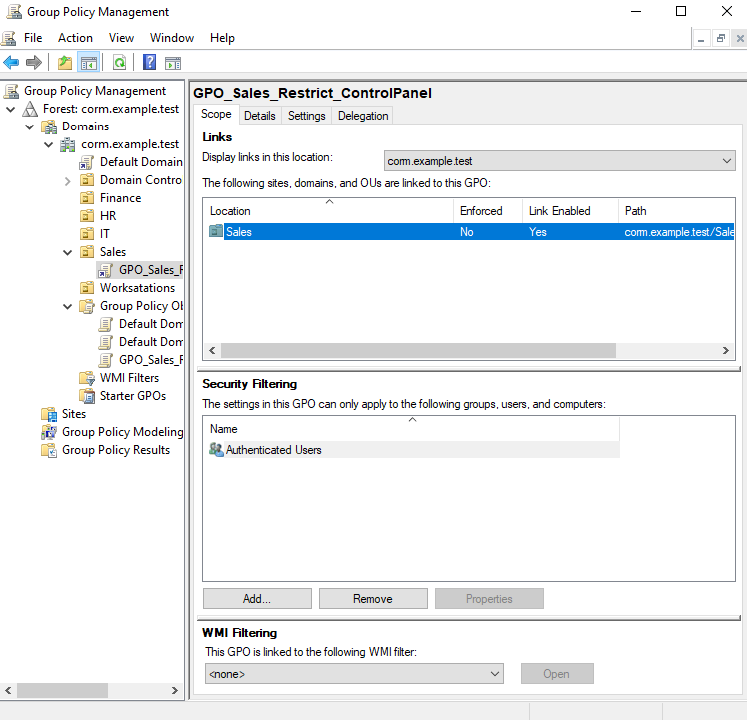
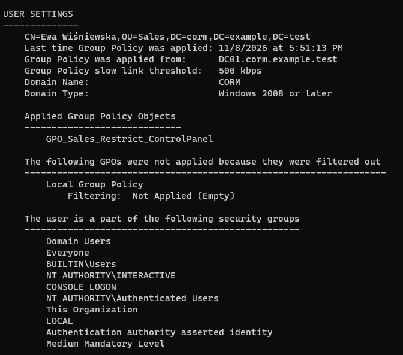
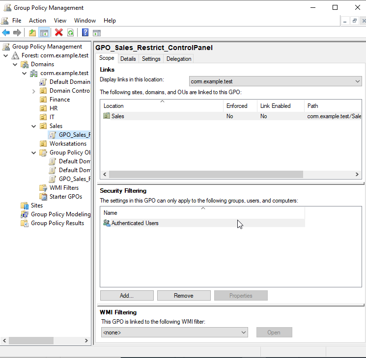
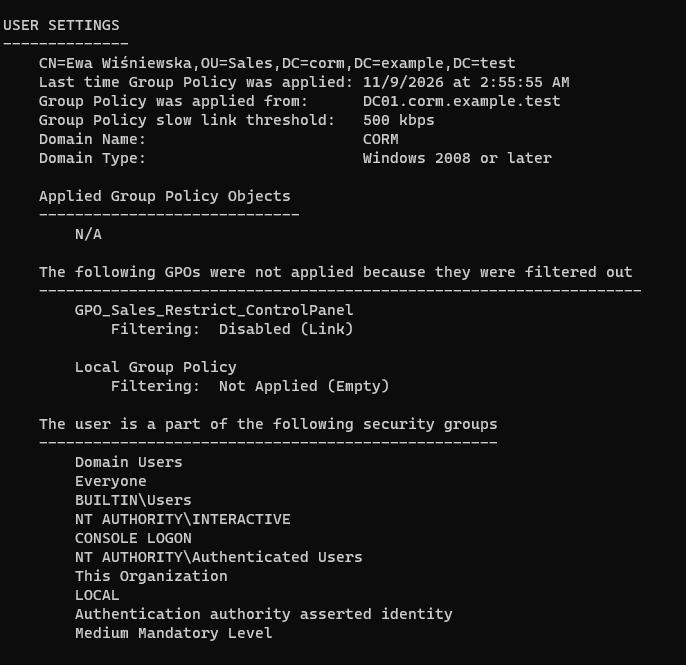
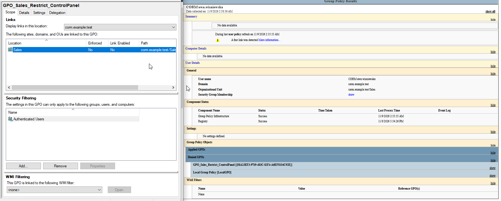
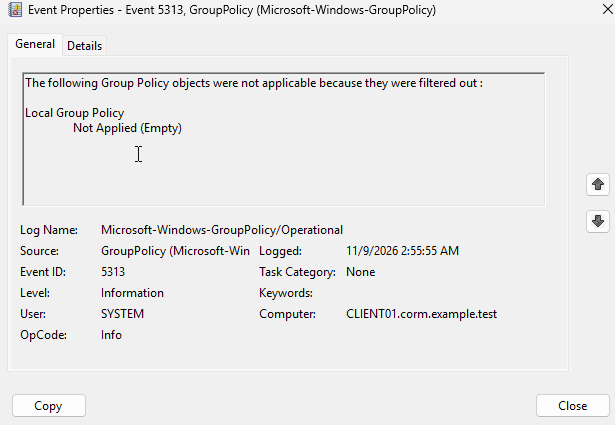
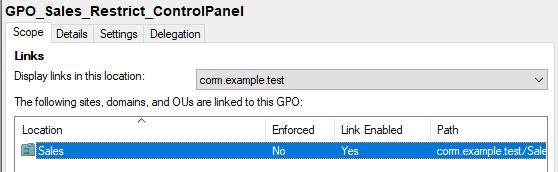
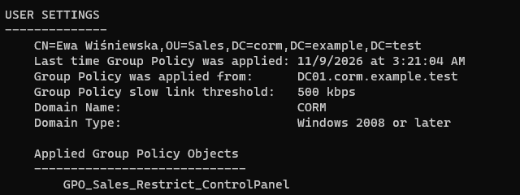

# HD-004 — Active Directory Group Policy Troubleshooting

**Project:** Corporate IT Support Home Lab  
**Ticket ID:** HD-004  
**Category:** Incident — Group Policy Management  
**Priority:** P3 — Normal (Lab Classification)  
**Status:** Resolved  
**Environment:** Windows Server 2022 / Windows 11 Enterprise / Active Directory Domain Services

---

## 1. Incident Overview

**Issue:** Group Policy restrictions were no longer being applied to a domain user.

**Scenario:** An employee from the Sales department reported that Windows Settings and Control Panel were accessible despite a previously configured company restriction.

The incident was simulated by intentionally disabling the Group Policy Object (GPO) link associated with the Sales Organizational Unit.

**Affected user:** `ewa.wisniewska`  
**Department:** Sales  
**Affected workstation:** `CLIENT01`  
**Affected GPO:** `GPO_Sales_Restrict_ControlPanel`  
**Domain:** `corp.example.test`

**Objective:** Investigate why the policy was no longer applied, identify the configuration issue, restore the GPO link, and validate policy enforcement.

*This incident was simulated in an isolated Active Directory home lab using fictional employee accounts.*

## 2. Lab Environment

| Component | Configuration |
|---|---|
| Domain Controller | DC01 |
| Server OS | Windows Server 2022 |
| Client Workstation | CLIENT01 |
| Client OS | Windows 11 Enterprise |
| Active Directory Domain | corp.example.test |
| NetBIOS Domain | CORM |
| Domain Controller IP | 10.20.XX.XX |
| Client IP | 10.20.XX.XX |
| Organizational Unit | Company → Sales |
| Virtualization | Oracle VirtualBox |

**Tools Used:**
- Group Policy Management Console (GPMC)
- Group Policy Management Editor
- Windows PowerShell
- gpupdate
- gpresult
- Windows Event Viewer
- Active Directory Domain Services

## 3. Initial GPO Configuration Assessment

The investigation began by reviewing the existing Group Policy configuration on the domain controller.

**GPO:** `GPO_Sales_Restrict_ControlPanel`  
**Linked OU:** `Sales`

The GPO was configured to restrict access to Control Panel and Windows Settings for users in the Sales department.

The relevant policy setting was located at:

```text
User Configuration
└── Policies
    └── Administrative Templates
        └── Control Panel
            └── Prohibit access to Control Panel and PC settings
```

The configuration review focused on:

- GPO link status.
- Organizational Unit association.
- Security Filtering.
- WMI Filtering.
- User Configuration settings.

The initial GPO link was enabled, with `Authenticated Users` configured under Security Filtering and no WMI filter applied.

**Evidence:**



## 4. Baseline Group Policy Verification

Before reproducing the incident, Group Policy application was checked on CLIENT01 using the affected domain account.

**Account:** `CORM\ewa.wisniewska`

The following commands were executed:

```powershell
whoami
gpresult /scope user /r
```

The `gpresult` command provides information about the policies applied to the current user.

The baseline assessment focused on verifying that `GPO_Sales_Restrict_ControlPanel` was included among the applied Group Policy Objects.

This established a reference point for the subsequent troubleshooting process.

**Evidence:**



## 5. Incident Reproduction — Disabled GPO Link

To reproduce the reported issue, the GPO link associated with the Sales OU was intentionally disabled.

**Procedure:**

1. Opened Group Policy Management on DC01.
2. Navigated to `corp.example.test → Company → Sales`.
3. Located `GPO_Sales_Restrict_ControlPanel`.
4. Disabled the **Link Enabled** option.
5. Verified the link status in GPMC.

The GPO itself was not deleted or disabled globally.

Disabling its link prevented the policy from applying through the Sales OU association.

The configuration displayed:

| Setting | Value |
|---|---|
| GPO | GPO_Sales_Restrict_ControlPanel |
| Linked OU | Sales |
| Enforced | No |
| Link Enabled | No |
| Security Filtering | Authenticated Users |
| WMI Filtering | None |

**Evidence:**



## 6. Group Policy Processing Investigation

Following the configuration change, Group Policy was refreshed on CLIENT01.

```powershell
gpupdate /force
```

The `/force` parameter requests reapplication of Group Policy settings.

A user logoff and subsequent logon were also part of the troubleshooting workflow.

The effective user policies were inspected using:

```powershell
gpresult /scope user /r
```

The investigation focused on whether `GPO_Sales_Restrict_ControlPanel` remained listed under Applied Group Policy Objects.

A missing GPO in the resulting policy report, combined with a disabled GPO link, helps identify a policy scope or configuration issue.

**Evidence:**



## 7. Advanced Troubleshooting — gpresult and Event Viewer

Additional diagnostics were performed using Group Policy reporting and Windows Event Viewer.

### 7.1 Group Policy Result Report

The following command was used to generate an HTML report:

```powershell
gpresult /scope user /h "$env:USERPROFILE\Desktop\GPO-Report.html" /f
```

The parameters specify:

- `/scope user` — generates user policy information.
- `/h` — creates an HTML report.
- `/f` — overwrites an existing report.

The report was used to investigate which policies applied to the user after the GPO link was disabled.

**Evidence:**



### 7.2 Windows Event Viewer Investigation

The Group Policy operational event log was inspected on CLIENT01.

**Location:**

`Event Viewer → Applications and Services Logs → Microsoft → Windows → GroupPolicy → Operational`

Two event IDs were examined.

**Event ID 5312 — Applicable Group Policy Objects**

The observed event displayed:

`List of applicable Group Policy objects: None`

This result reflects the particular Group Policy processing activity associated with that event. It does not independently establish that the Sales GPO was incorrectly configured.

**Event ID 5313 — Filtered Group Policy Objects**

The observed event displayed:

```text
Local Group Policy
Not Applied (Empty)
```

This indicated that the local Group Policy was not applicable during that processing cycle because it contained no relevant settings.

Both observed events were informational and did not indicate a Group Policy processing failure.

The event logs were used as supplementary diagnostic evidence rather than as the sole proof of the root cause.

**Additional Evidence:**



## 8. Root Cause Identification

The investigation identified a configuration issue in Group Policy Management.

The link connecting `GPO_Sales_Restrict_ControlPanel` to the Sales Organizational Unit had been disabled.

Because the policy contained user-level settings, its application depended on the affected user being within the appropriate scope of the GPO.

**Root Cause:** Disabled GPO link on the Sales OU.

This was a configuration issue rather than a failure of the Active Directory service or the Group Policy processing engine.

## 9. Resolution — Restoring the GPO Link

The configuration issue was addressed on DC01 using Group Policy Management.

**Procedure:**

1. Opened Group Policy Management.
2. Navigated to `Company → Sales`.
3. Located `GPO_Sales_Restrict_ControlPanel`.
4. Re-enabled **Link Enabled**.
5. Reviewed the GPO link configuration.

The intended restored configuration was:

| Setting | Value |
|---|---|
| Linked OU | Sales |
| Link Enabled | Yes |
| Security Filtering | Authenticated Users |
| WMI Filtering | None |

The original GPO was retained without recreating or deleting the policy object.

**Evidence:**



## 10. Post-Resolution Validation

After restoring the GPO link, Group Policy was refreshed on CLIENT01.

```powershell
gpupdate /force
```

The effective user policies were then checked using:

```powershell
gpresult /scope user /r
```

The validation process focused on confirming that the restored Sales GPO appeared in the applied policy list.

Additional domain checks included:

```powershell
whoami
$env:USERDNSDOMAIN
Test-ComputerSecureChannel
```

These commands were used to inspect:

- The authenticated domain user.
- The domain associated with the current session.
- The workstation's secure channel with Active Directory.

The final functional check involved testing whether access to Control Panel and Windows Settings was restricted again.

**Evidence:**



## 11. Resolution Summary

**Symptom:** The Sales department's Windows Settings and Control Panel restrictions stopped applying.

**Technical Finding:** The affected GPO was no longer being applied through its intended Organizational Unit link.

**Root Cause:** The GPO link associated with the Sales OU was disabled.

**Resolution:** The existing GPO link was re-enabled through Group Policy Management.

**Validation Method:** Group Policy refresh, effective policy inspection using `gpresult`, and functional testing of the Windows restrictions.

**Ticket Status:** Resolved.

## 12. Security and Operational Considerations

This exercise highlighted several important Group Policy administration principles:

- A correctly configured GPO may not apply if its link is disabled.
- GPO scope and Organizational Unit placement affect policy application.
- User Configuration and Computer Configuration apply in different contexts.
- Security Filtering and WMI Filtering can affect policy eligibility.
- Group Policy processing should be verified using resultant policy reports.
- Informational Event Viewer entries do not necessarily indicate errors.
- Group Policy changes should be documented and verified.
- Production GPO changes should follow an approved change management process.
- Troubleshooting should focus on identifying the root cause rather than repeatedly forcing policy updates.

## 13. Skills Demonstrated

- Active Directory Group Policy administration
- Group Policy Management Console (GPMC)
- Organizational Unit and GPO link troubleshooting
- Group Policy scope analysis
- Resultant Set of Policy investigation
- Windows Event Viewer analysis
- PowerShell-based domain validation
- Group Policy incident resolution
- IT Support troubleshooting methodology
- Root cause analysis
- Technical documentation

## 14. Lessons Learned

This exercise demonstrated that Group Policy troubleshooting requires an understanding of how policies are linked, filtered, and processed.

A GPO can retain all of its configured settings while no longer affecting users because its Organizational Unit link has been disabled.

The investigation also highlighted the difference between a policy configuration issue and an actual Group Policy processing error.

By combining GPMC inspection, `gpresult`, Windows Event Viewer, and functional testing, an administrator can identify the cause of a Group Policy issue and verify that the intended configuration has been restored.

---

**Lab Type:** Personal IT Support Training Environment  
**Scope:** Authorized, isolated Active Directory Home Lab  
**Purpose:** Practical preparation for IT Support, Helpdesk, and Junior System Administrator roles
