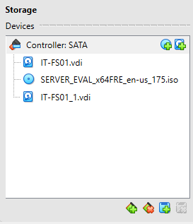
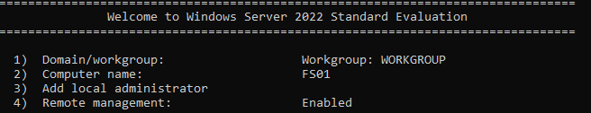

# HD-005 — Shared Folder Access Denied

**Project:** Corporate IT Support Home Lab  
**Ticket ID:** HD-005  
**Category:** File Server / SMB / NTFS Permissions  
**Priority:** Medium  
**Status:** Resolved  
**Environment:** Windows Server 2022, Windows 11, Active Directory, VirtualBox

---

## 1. Overview

This project simulates a real-world IT Support incident in which an employee is unable to access a shared network folder.

The objective was to deploy a dedicated Windows File Server, configure SMB and NTFS permissions, reproduce an access-related incident, identify its root cause, restore access, and verify the resolution.

The exercise was performed in an isolated Active Directory home lab.

**Technologies used:**
- Windows Server 2022 Server Core
- Windows 11 Enterprise
- Active Directory Domain Services
- SMB File Sharing
- NTFS Permissions
- PowerShell
- TCP/IP and DNS
- Oracle VirtualBox

## 2. Helpdesk Ticket

**Ticket:** HD-005 — Shared Folder Access Denied  
**Reported by:** Anna Kowalska  
**Department:** Human Resources  
**Issue:** Unable to access the shared HR network folder

**User report:**

> Hello, I'm trying to access our HR shared folder, but Windows keeps showing "Access is denied." My colleagues can open it without any problems. Could you please help?

**Expected behavior:**

Authorized HR employees should be able to access and modify files within the HR network share.

**Actual behavior:**

Access to the shared folder was denied after an intentional SMB permissions misconfiguration.

## 3. Lab Environment

| Component | Configuration |
|---|---|
| Hypervisor | Oracle VirtualBox |
| Domain Controller | DC01 |
| File Server | FS01 |
| Client | CLIENT01 |
| Domain | corp.example.test |
| NetBIOS | CORM |
| DC01 IPv4 | 10.20.30.10 |
| FS01 IPv4 | 10.20.30.20 |
| CLIENT01 IPv4 | 10.20.30.101 |
| Internal Network | IT_SUPPORT_LAN |
| File Server OS | Windows Server 2022 Standard Evaluation (Server Core) |
| Client OS | Windows 11 Enterprise |
| File Server Data Drive | Y: |
| Network Share | \\FS01\HR |
| Security Group | CORM\GG_HR |

The File Server was deployed as a separate domain-joined machine rather than hosting shared files directly on the Domain Controller.

This architecture separates identity management from file storage services and provides experience managing multiple Windows servers.

### Virtual Machine Configuration

The FS01 virtual machine was created with:

- 2 virtual CPUs
- 4 GB RAM
- 50 GB system disk
- 30 GB additional data disk
- Internal Network adapter
- NAT adapter



## 4. Initial File Server Configuration

Windows Server 2022 Server Core was installed on FS01.

The system was configured using SConfig and PowerShell.

The computer was renamed to `FS01`, and remote management was enabled.



### Network Configuration

The internal network adapter was configured with:

| Setting | Value |
|---|---|
| IPv4 Address | 10.20.30.20 |
| Subnet Mask | 255.255.255.0 |
| DNS Server | 10.20.30.10 |
| Default Gateway | None on the internal adapter |

Network settings were checked using:

```powershell
Get-NetAdapter
Get-NetIPConfiguration
```

The internal network uses the Domain Controller for DNS resolution.


### Connectivity Verification

Before joining the domain, network connectivity and DNS resolution were tested:

```powershell
Test-Connection 10.20.30.10 -Count 4

Resolve-DnsName dc01.corp.example.test

Resolve-DnsName -Type SRV _ldap._tcp.dc._msdcs.corp.example.test
```

These commands validate connectivity to the Domain Controller, hostname resolution, and Active Directory service discovery.


## 5. Active Directory Domain Join

FS01 was joined to the existing Active Directory domain using PowerShell:

```powershell
Add-Computer -DomainName "corp.example.test" `
    -Credential "CORM\Administrator" `
    -Restart
```

After restarting, domain membership and the secure channel were verified:

```powershell
Get-CimInstance Win32_ComputerSystem |
    Select-Object Name, Domain, PartOfDomain

Test-ComputerSecureChannel
```

The configuration confirmed that FS01 was operating as a domain-joined member server.


## 6. Data Disk Configuration

A dedicated data disk was configured for shared departmental resources.

The disk was initialized, partitioned, and formatted using NTFS.

The final drive letter assigned to the data volume was `Y:`.

Disk information was inspected using:

```powershell
Get-Disk
Get-Partition
Get-Volume
```

The data volume was verified using:

```powershell
Get-Volume -DriveLetter Y
```

Separating shared company data from the operating system provides a clearer storage structure and simplifies future administration.


## 7. File Server Role Installation

The Windows File Server role was configured on FS01.

The feature was checked using:

```powershell
Get-WindowsFeature FS-FileServer
```

The installation command was:

```powershell
Install-WindowsFeature FS-FileServer
```

The role and SMB Server service were verified using:

```powershell
Get-WindowsFeature FS-FileServer

Get-Service LanmanServer
```

The `LanmanServer` service provides server-side SMB file sharing functionality.


## 8. Departmental Folder Structure

A basic company folder structure was created on the Y: drive.

```text
Y:\
└── Shares
    ├── HR
    ├── Finance
    ├── Sales
    └── IT
```

The directories were created using PowerShell:

```powershell
New-Item -Path "Y:\Shares" -ItemType Directory

New-Item -Path "Y:\Shares\HR" -ItemType Directory
New-Item -Path "Y:\Shares\Finance" -ItemType Directory
New-Item -Path "Y:\Shares\Sales" -ItemType Directory
New-Item -Path "Y:\Shares\IT" -ItemType Directory
```

The folder structure was inspected using:

```powershell
Get-ChildItem Y:\Shares
```


## 9. SMB and NTFS Permissions

The HR folder was configured using Active Directory security group-based access control.

### NTFS Permissions

The following permissions were configured:

| Security Principal | Permission |
|---|---|
| CORM\Domain Admins | Full Control |
| NT AUTHORITY\SYSTEM | Full Control |
| CORM\GG_HR | Modify |

The folder permissions were configured using:

```powershell
icacls "Y:\Shares\HR" /inheritance:r

icacls "Y:\Shares\HR" /grant:r `
    "CORM\Domain Admins:(OI)(CI)F" `
    "NT AUTHORITY\SYSTEM:(OI)(CI)F" `
    "CORM\GG_HR:(OI)(CI)M"
```

**Parameter explanation:**

- `/inheritance:r` — removes inherited permission entries.
- `(OI)` — applies permissions to child files.
- `(CI)` — applies permissions to child folders.
- `F` — Full Control.
- `M` — Modify.

The permissions were inspected using:

```powershell
icacls "Y:\Shares\HR"
```

### SMB Share Permissions

The HR network share was created using:

```powershell
New-SmbShare -Name "HR" `
    -Path "Y:\Shares\HR" `
    -ChangeAccess "CORM\GG_HR" `
    -FullAccess "CORM\Domain Admins"
```

Share settings were inspected using:

```powershell
Get-SmbShare -Name "HR"

Get-SmbShareAccess -Name "HR"
```

This configuration allows authorized HR users to modify files while retaining administrative access.


## 10. Baseline Access Verification

Before introducing the incident, access to the shared folder was tested using CLIENT01.

The test account was:

`CORM\anna.kowalska`

The network location was:

```text
\\FS01\HR
```

The HR user successfully accessed the shared folder and created a test file.

This confirmed that the share was functioning before the intentional permissions misconfiguration.


## 11. Incident Simulation

To reproduce the reported problem, an explicit Deny entry was intentionally introduced at the SMB share level.

The original permissions were checked:

```powershell
Get-SmbShareAccess -Name "HR"
```

The following command introduced the restriction:

```powershell
Block-SmbShareAccess -Name "HR" `
    -AccountName "CORM\GG_HR"
```

The permissions were inspected again:

```powershell
Get-SmbShareAccess -Name "HR"
```

The new Deny entry affected members of the HR security group.

This demonstrated how share-level permissions can prevent network access even when NTFS permissions permit modification.


## 12. Reproducing the Access Denied Error

The incident was reproduced from CLIENT01 using the affected domain account.

The existing SMB connection was disconnected:

```cmd
net use \\FS01\HR /delete
```

The user then attempted to access:

```text
\\FS01\HR
```

Windows displayed an access-denied error, confirming that the simulated incident could be reproduced.


## 13. Troubleshooting and Diagnostics

The investigation focused on distinguishing between identity, connectivity, SMB permissions, and NTFS permissions.

### Step 1 — Verify User Identity

The following commands were executed on CLIENT01:

```cmd
whoami

whoami /groups
```

These commands identify the currently authenticated user and display security group membership.

They help determine whether the affected account belongs to the expected Active Directory group.

### Step 2 — Verify SMB Connectivity

PowerShell was used to test connectivity to TCP port 445:

```powershell
Test-NetConnection FS01 -Port 445
```

Port 445 is used for SMB communication.

A successful connection indicates that the SMB service is reachable over TCP, but it does not guarantee permission to access a specific folder.


### Step 3 — Compare Share and NTFS Permissions

On FS01, SMB permissions were inspected:

```powershell
Get-SmbShareAccess -Name "HR"
```

NTFS permissions were checked separately:

```powershell
icacls "Y:\Shares\HR"
```

The comparison identified a deliberately introduced SMB Deny entry affecting `CORM\GG_HR`.

The HR group retained its intended NTFS Modify permissions, but the SMB share-level restriction prevented network access.


## 14. Root Cause Analysis

**Root Cause: Incorrect SMB Share Permissions**

The incident was caused by an explicit Deny entry assigned to the Active Directory security group `CORM\GG_HR`.

The affected user belonged to this group, so the configured restriction prevented access to the network share.

The NTFS permissions were not the cause of the incident.

### Technical Explanation

When users access a shared folder over the network, Windows evaluates both SMB Share Permissions and NTFS Permissions.

The user's effective access is limited by the combined permission configuration.

Even if NTFS permissions allow modifying files, access may still be denied by the SMB share permissions.

This distinction was central to identifying the root cause.

## 15. Resolution

The incorrectly configured SMB Deny entry was removed using:

```powershell
Unblock-SmbShareAccess -Name "HR" `
    -AccountName "CORM\GG_HR"
```

The permissions were then inspected again:

```powershell
Get-SmbShareAccess -Name "HR"
```

The corrective action removed the intentionally introduced share-level restriction without modifying the existing NTFS permissions.


## 16. Final Validation

After restoring the permissions, the network connection was refreshed on CLIENT01.

The affected user accessed:

```text
\\FS01\HR
```

The following operations were tested:

1. Opening the shared folder.
2. Creating a test file.
3. Editing and saving file contents.
4. Deleting the test file.

These operations confirmed that access had been restored and the user could modify files within the HR share.


**Final Ticket Status: Resolved**

## 17. Lessons Learned

### SMB Share vs NTFS Permissions

Both share-level and filesystem-level permissions must be considered when troubleshooting network folder access.

### Active Directory Group Management

Using security groups provides centralized access management and simplifies permission assignments.

### Baseline Verification

Testing a service before introducing a simulated fault establishes a reliable reference point for troubleshooting.

### Structured Troubleshooting

Checking user identity, connectivity, and access permissions separately helps isolate the root cause of access problems.

### Principle of Least Privilege

Users should receive only the permissions necessary to perform their responsibilities.

### Windows Server Core Administration

Windows Server Core can be deployed, configured, and managed using PowerShell without a graphical desktop environment.

## 18. Skills Demonstrated

- Windows Server 2022 Server Core administration
- Active Directory Domain Join
- Windows File Server deployment
- SMB configuration and troubleshooting
- NTFS permission management
- Active Directory security groups
- PowerShell administration
- TCP/IP and DNS troubleshooting
- Windows client support
- Access Denied troubleshooting
- Root cause analysis
- Incident simulation and recovery
- Technical documentation

## 19. Project Structure

```text
HD-005-Shared-Folder-Access-Denied/
│
├── README.md
│
└── screenshots/
    ├── 00-file-server-vm-configuration.png
    ├── 01-fs01-initial-configuration.png
    ├── 02-fs01-network-configuration.png
    ├── 03-fs01-connectivity-tests.png
    ├── 04-fs01-domain-join.png
    ├── 05-fs01-data-disk.png
    ├── 06-fs01-file-server-role.png
    ├── 07-fs01-folder-structure.png
    ├── 08-fs01-smb-permissions.png
    ├── 09-hr-share-working-baseline.png
    ├── 10-hr-share-access-denied-config.png
    ├── 11-hr-access-denied-error.png
    ├── 12-user-and-smb-diagnostics.png
    ├── 13-share-vs-ntfs-diagnostics.png
    ├── 14-hr-permissions-restored.png
    └── 15-hr-access-restored-validation.png
```

---

## Disclaimer

This project was completed in a controlled, isolated home laboratory using virtual machines and fictional employee accounts.

The incident was intentionally simulated for educational and professional development purposes.

It does not represent a production environment or an actual corporate incident.

---

**GitHub:** [NikoBialkow](https://github.com/NikoBialkow)

**Focus:** IT Support | Windows Server | Active Directory | Troubleshooting
