# HD-005 — Shared Folder Access Denied

**Project:** Corporate IT Support Home Lab  
**Ticket ID:** HD-005  
**Category:** File Server / SMB / NTFS Permissions  
**Priority:** Medium  
**Status:** Resolved  
**Environment:** Windows Server 2022, Windows 11, Active Directory, VirtualBox

---

## 1. Overview

This project simulates a real-world IT Support incident in which an employee is unable to access a shared network folder.

The objective was to deploy a dedicated Windows File Server, configure SMB and NTFS permissions, reproduce an access-related incident, identify its root cause, restore access, and verify the resolution.

The exercise was performed in an isolated Active Directory home lab.

**Key technologies:**
- Windows Server 2022 Server Core
- Windows 11
- Active Directory Domain Services (AD DS)
- SMB File Sharing
- NTFS Permissions
- PowerShell
- TCP/IP and DNS
- Oracle VirtualBox

## 2. Helpdesk Ticket

**Ticket:** HD-005 — Shared Folder Access Denied  
**Reported by:** Anna Kowalska  
**Department:** Human Resources  
**Issue:** Unable to access the shared HR network folder

**User report:**

> Hello, I'm trying to access our HR shared folder, but Windows keeps showing "Access is denied." My colleagues can open it without any problems. Could you please help?

**Expected behavior:**

Authorized HR employees should be able to access and modify files within the HR network share.

**Actual behavior during the incident:**

Access to the shared folder was denied after an intentional SMB permissions misconfiguration.

## 3. Lab Environment

| Component | Configuration |
|---|---|
| Hypervisor | Oracle VirtualBox |
| Domain Controller | DC01 |
| File Server | FS01 |
| Client | CLIENT01 |
| Domain | corp.example.test |
| NetBIOS | CORM |
| DC01 IPv4 | 10.20.30.10 |
| FS01 IPv4 | 10.20.30.20 |
| CLIENT01 IPv4 | 10.20.30.101 |
| Internal Network | IT_SUPPORT_LAN |
| File Server OS | Windows Server 2022 Standard Evaluation (Server Core) |
| Client OS | Windows 11 Enterprise |
| File Server Data Drive | Y: |
| Network Share | \\FS01\HR |
| Security Group | CORM\GG_HR |

The File Server was deployed as a separate domain-joined machine rather than hosting shared files directly on the Domain Controller.

This architecture provides separation between identity management and file storage services.

## 4. File Server Deployment

A new virtual machine named `IT-FS01` was created using Windows Server 2022 Server Core.

The server was configured with:

- A dedicated system disk.
- A separate data disk.
- An internal network adapter connected to `IT_SUPPORT_LAN`.
- An additional NAT adapter for internet connectivity.

The computer was renamed to `FS01` and configured with the internal IPv4 address `10.20.30.20/24`, using the Domain Controller at `10.20.30.10` for DNS resolution.

### Network and Domain Verification

The following commands were used:

```powershell
Get-NetIPConfiguration

Test-Connection 10.20.30.10 -Count 4

Resolve-DnsName dc01.corp.example.test

Resolve-DnsName -Type SRV _ldap._tcp.dc._msdcs.corp.example.test
```

These checks were used to validate IP connectivity, DNS resolution, and Active Directory service discovery.

The server was joined to the existing domain:

```powershell
Add-Computer -DomainName "corp.example.test" `
    -Credential "CORM\Administrator" `
    -Restart
```

Domain membership was checked using:

```powershell
Get-CimInstance Win32_ComputerSystem |
    Select-Object Name, Domain, PartOfDomain

Test-ComputerSecureChannel
```

### Evidence


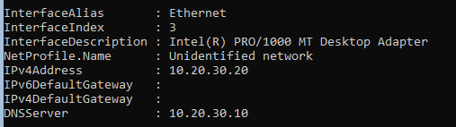

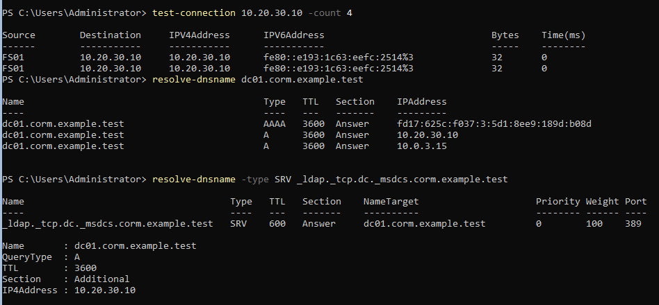

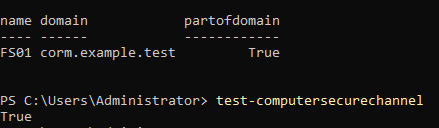

## 5. File Server Configuration

### Data Drive

A separate data volume was prepared using NTFS and assigned drive letter `Y:`.

Disk and volume information was checked with:

```powershell
Get-Disk
Get-Partition
Get-Volume
```

The data drive was verified using:

```powershell
Get-Volume -DriveLetter Y
```

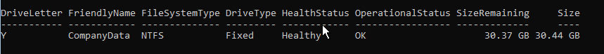

### File Server Role

The Windows File Server role was checked and installed if required:

```powershell
Get-WindowsFeature FS-FileServer

Install-WindowsFeature FS-FileServer
```

The role and Server service were verified using:

```powershell
Get-WindowsFeature FS-FileServer

Get-Service LanmanServer
```

The `LanmanServer` service provides server-side SMB file sharing functionality.

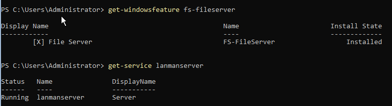

## 6. Shared Folder Structure

A basic departmental folder structure was created on the data drive:

```text
Y:\
└── Shares
    ├── HR
    ├── Finance
    ├── Sales
    └── IT
```

The directories were created using PowerShell:

```powershell
New-Item -Path "Y:\Shares" -ItemType Directory

New-Item -Path "Y:\Shares\HR" -ItemType Directory
New-Item -Path "Y:\Shares\Finance" -ItemType Directory
New-Item -Path "Y:\Shares\Sales" -ItemType Directory
New-Item -Path "Y:\Shares\IT" -ItemType Directory
```

The directory structure was verified using:

```powershell
Get-ChildItem Y:\Shares
```

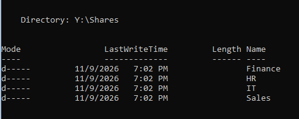

## 7. SMB and NTFS Permissions

The HR folder was configured to use Active Directory security group-based access control.

### NTFS Permissions

The intended NTFS permissions were:

| Security Principal | Permission |
|---|---|
| CORM\Domain Admins | Full Control |
| NT AUTHORITY\SYSTEM | Full Control |
| CORM\GG_HR | Modify |

The permissions were configured using:

```powershell
icacls "Y:\Shares\HR" /inheritance:r

icacls "Y:\Shares\HR" /grant:r `
    "CORM\Domain Admins:(OI)(CI)F" `
    "NT AUTHORITY\SYSTEM:(OI)(CI)F" `
    "CORM\GG_HR:(OI)(CI)M"
```

The parameters have the following meanings:

- `/inheritance:r` — disables inheritance and removes inherited permission entries.
- `(OI)` — Object Inherit, applying permissions to files.
- `(CI)` — Container Inherit, applying permissions to subfolders.
- `F` — Full Control.
- `M` — Modify.

The resulting permissions were inspected using:

```powershell
icacls "Y:\Shares\HR"
```

### SMB Share Permissions

An SMB share named `HR` was configured:

```powershell
New-SmbShare -Name "HR" `
    -Path "Y:\Shares\HR" `
    -ChangeAccess "CORM\GG_HR" `
    -FullAccess "CORM\Domain Admins"
```

The configured share permissions were inspected using:

```powershell
Get-SmbShare -Name "HR"

Get-SmbShareAccess -Name "HR"
```

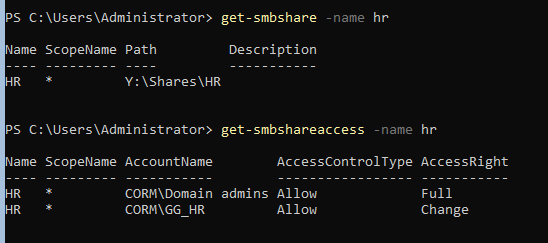

## 8. Baseline Access Verification

Before introducing the incident, the shared folder was tested from the domain-joined Windows 11 client.

The test was performed using the domain account:

`CORM\anna.kowalska`

The network path was:

```text
\\FS01\HR
```

The user was able to access the folder and create a test file, confirming functional access before the simulated incident.

The baseline established that the share was available and accessible to an authorized HR user.

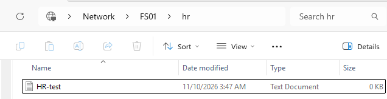

## 9. Incident Simulation

To reproduce the reported issue, SMB share permissions were intentionally modified on FS01.

The original share permissions were inspected:

```powershell
Get-SmbShareAccess -Name "HR"
```

An explicit Deny entry was introduced for the HR security group:

```powershell
Block-SmbShareAccess -Name "HR" `
    -AccountName "CORM\GG_HR"
```

The updated permissions were checked:

```powershell
Get-SmbShareAccess -Name "HR"
```

This configuration introduced an explicit SMB share-level restriction affecting members of the HR group.

Even when NTFS permissions allow access, an explicit Deny at the SMB share level can prevent network access.

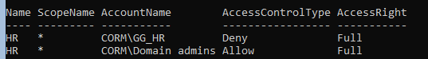

## 10. Reproducing the User Issue

The issue was tested on CLIENT01 using the domain account `CORM\anna.kowalska`.

The existing SMB connection was disconnected using:

```cmd
net use \\FS01\HR /delete
```

The user then attempted to access:

```text
\\FS01\HR
```

Windows displayed an access-denied error, reproducing the simulated helpdesk incident.

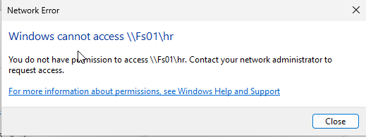

## 11. Troubleshooting and Diagnostics

The investigation focused on identifying whether the problem was caused by:

- Incorrect user identity or group membership.
- Network connectivity failure.
- SMB service unavailability.
- Incorrect SMB share permissions.
- Incorrect NTFS permissions.

### Step 1 — Verify User Identity

On CLIENT01:

```cmd
whoami

whoami /groups
```

These commands were used to inspect the logged-in identity and security group membership.

### Step 2 — Verify SMB Connectivity

On CLIENT01, PowerShell was used to test TCP connectivity:

```powershell
Test-NetConnection FS01 -Port 445
```

TCP port 445 is used by SMB.

A successful TCP connection indicates that the SMB service is reachable over the network, but it does not establish that the user has permission to access the share.

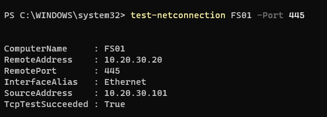

### Step 3 — Compare Share and NTFS Permissions

On FS01, SMB permissions were checked using:

```powershell
Get-SmbShareAccess -Name "HR"
```

NTFS permissions were inspected using:

```powershell
icacls "Y:\Shares\HR"
```

The comparison identified the deliberately introduced SMB share-level Deny entry.

The NTFS configuration allowed the HR group to modify folder contents, while the SMB share restriction prevented network access.

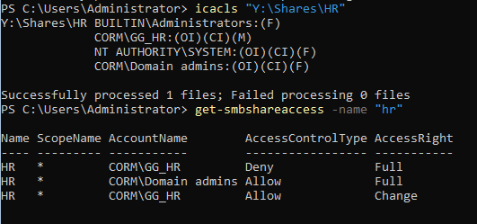

## 12. Root Cause Analysis

**Root Cause: Incorrect SMB Share Permissions**

The incident was caused by an explicit Deny entry assigned to the Active Directory security group `CORM\GG_HR` at the SMB share level.

The affected user belonged to the HR group, and therefore the share-level restriction prevented access to the network folder.

The NTFS permissions were not the cause of the incident.

### Technical Explanation

Windows evaluates both SMB share permissions and NTFS permissions when a network resource is accessed.

The effective access is restricted by the combined permission configuration.

A user may have NTFS Modify permissions and still be unable to access a folder over SMB if the share permissions deny access.

This distinction was central to the troubleshooting process.

## 13. Resolution

The incorrectly configured SMB Deny entry was removed using:

```powershell
Unblock-SmbShareAccess -Name "HR" `
    -AccountName "CORM\GG_HR"
```

The share permissions were inspected again:

```powershell
Get-SmbShareAccess -Name "HR"
```

The corrective action restored the intended share access without unnecessarily modifying the existing NTFS permissions.

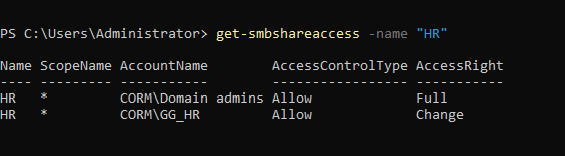

## 14. Final Validation

After the permissions were restored, the network connection was refreshed on CLIENT01.

The user accessed:

```text
\\FS01\HR
```

The following operations were tested:

1. Opening the HR shared folder.
2. Creating a test file.
3. Editing and saving file contents.
4. Deleting the test file.

The successful operations confirmed that the HR user's access had been restored.

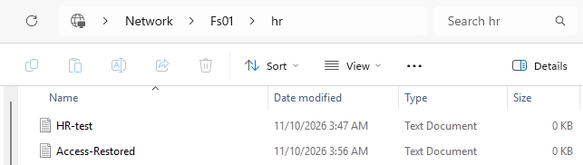

**Final Status: Resolved**

## 15. Lessons Learned

### SMB Share vs NTFS Permissions

Share permissions and NTFS permissions serve different purposes and must be evaluated together when troubleshooting network folder access.

### Group-Based Access Control

Using Active Directory security groups simplifies permission management and allows administrators to assign access based on organizational roles.

### Importance of Baseline Testing

Verifying correct functionality before introducing a failure helps distinguish an existing configuration problem from the simulated incident.

### Structured Troubleshooting

A systematic investigation should separate identity, network connectivity, service availability, and authorization issues.

### Principle of Least Privilege

Users should receive only the permissions required to perform their job responsibilities.

### Server Core Administration

Windows Server Core can be configured and administered using PowerShell without a full graphical desktop environment.

This project provided additional practical experience in command-line server administration.

## 16. Skills Demonstrated

- Windows Server 2022 Core administration
- Active Directory domain integration
- Windows File Server deployment
- SMB share configuration
- NTFS access control
- Active Directory security group management
- PowerShell administration
- Windows client troubleshooting
- Network and DNS validation
- Root cause analysis
- Incident simulation and resolution
- Technical documentation

## 17. Project Structure

```text
HD-005-Shared-Folder-Access-Denied/
│
├── README.md
│
└── screenshots/
    ├── 01-fs01-hostname.png
    ├── 02-fs01-network-configuration.png
    ├── 03-fs01-connectivity-tests.png
    ├── 04-fs01-domain-join.png
    ├── 05-fs01-data-disk.png
    ├── 06-fs01-file-server-role.png
    ├── 07-fs01-folder-structure.png
    ├── 08-fs01-smb-permissions.png
    ├── 09-hr-share-working-baseline.png
    ├── 10-hr-share-access-denied-config.png
    ├── 11-hr-access-denied-error.png
    ├── 12-user-and-smb-diagnostics.png
    ├── 13-share-vs-ntfs-diagnostics.png
    ├── 14-hr-permissions-restored.png
    └── 15-hr-access-restored-validation.png
```

---

## Disclaimer

This project was performed in a controlled, isolated home laboratory using virtual machines and fictional employee accounts.

The incident was intentionally simulated for educational purposes.

It does not represent a production environment or an actual corporate security incident.

---

**Project Repository:** [NikoBialkow — GitHub](https://github.com/NikoBialkow)

**Focus:** IT Support | Windows Server | Active Directory | Troubleshooting
