# HD-006 — Network Drive Mapping via Group Policy

**Project:** Corporate IT Support Home Lab  
**Ticket ID:** HD-006  
**Category:** Active Directory / Group Policy / Network Drives  
**Priority:** Medium  
**Status:** Resolved  
**Environment:** Windows Server 2022, Windows 11, Active Directory, VirtualBox

---

## 1. Overview

This project simulates an IT Support incident in which an employee's mapped network drive disappears from File Explorer, even though the underlying file share remains available.

The objective was to configure automatic network drive mapping through Group Policy Preferences (GPP), establish a working baseline, reproduce a mapping failure, investigate its cause, and restore the expected functionality.

The exercise was conducted in an isolated Active Directory home lab using an existing Domain Controller, a dedicated File Server, and a domain-joined Windows client.

**Technologies used:**
- Windows Server 2022
- Windows 11 Enterprise
- Active Directory Domain Services (AD DS)
- Group Policy Management Console (GPMC)
- Group Policy Preferences (GPP)
- SMB File Sharing
- PowerShell and Command Prompt
- Windows Event Viewer
- Oracle VirtualBox

## 2. Helpdesk Ticket

**Ticket:** HD-006 — Network Drive Not Mapped  
**Reported by:** Anna Kowalska  
**Department:** Human Resources  
**Issue:** Missing HR network drive after signing in

**User report:**

> Hello, my HR network drive (H:) is missing from File Explorer. I can access the shared folder manually using the network path, but the drive no longer appears automatically when I sign in. Could you please help?

### Expected Behavior

Employees in the HR organizational unit should automatically receive the mapped network drive `H:` after signing in to a domain-joined workstation.

The drive should point to:

`\\FS01\HR`

### Incident Behavior

The drive mapping stopped being created automatically after its Group Policy Preference item was intentionally disabled.

The investigation focused on determining whether the issue originated from network connectivity, SMB availability, Active Directory policy processing, or the drive mapping configuration.

## 3. Lab Environment

| Component | Configuration |
|---|---|
| Hypervisor | Oracle VirtualBox |
| Domain Controller | DC01 |
| File Server | FS01 |
| Client Workstation | CLIENT01 |
| Domain | corp.example.test |
| NetBIOS | CORM |
| DC01 IP | 10.20.30.10 |
| FS01 IP | 10.20.30.20 |
| CLIENT01 IP | 10.20.30.101 |
| Network | IT_SUPPORT_LAN |
| File Server OS | Windows Server 2022 Server Core |
| Client OS | Windows 11 Enterprise |
| File Server Data Drive | Y: |
| SMB Share | \\FS01\HR |
| Mapped Drive | H: |
| AD Security Group | GG_HR |
| Group Policy Object | GPO_HR_Map_NetworkDrive |

### Infrastructure

The existing File Server FS01 was configured during HD-005.

Its HR shared folder was located at:

`Y:\Shares\HR`

The client was able to access the shared resource through its UNC path.

For HD-006, an additional configuration was introduced to automatically map this network resource to drive letter `H:`.

This allowed employees to access the HR share directly from File Explorer without manually entering the network path.

## 4. Existing SMB Share Verification

Before configuring Group Policy, the existing HR share was inspected on FS01.

The following PowerShell commands were used:

```powershell
Get-SmbShare -Name HR

Get-SmbShareAccess -Name HR

Test-Path "Y:\Shares\HR"
```

These checks were intended to verify:

- The existence of the HR network share.
- The configured share permissions.
- The availability of the underlying directory.

Establishing a working SMB resource was necessary before troubleshooting automated drive mapping.

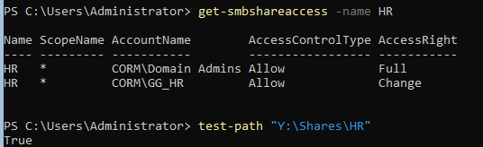

## 5. Group Policy Object Creation

A dedicated GPO was created on DC01 using Group Policy Management.

**GPO name:**

`GPO_HR_Map_NetworkDrive`

**Linked Organizational Unit:**

`corp.example.test → Company → HR`

The policy was linked to the HR OU because it contained user-specific settings.

Unlike computer policies, user policies generally apply based on the location and scope of the user account in Active Directory.

This configuration allows the same HR user to receive the mapped drive when signing in to different domain-joined workstations within the GPO's applicable scope.

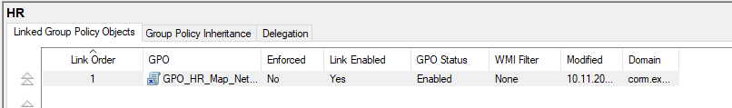

## 6. Drive Mapping Configuration

The GPO was edited using the Group Policy Management Editor.

The following location was used:

**User Configuration → Preferences → Windows Settings → Drive Maps**

A new mapped drive preference item was created with the following settings:

| Setting | Value |
|---|---|
| Action | Update |
| Location | \\FS01\HR |
| Drive Letter | H: |
| Label | HR Shared Drive |
| Reconnect | Enabled |

### Why Use the Update Action?

The `Update` action can create the mapped drive if it does not exist and update its configuration when the preference item is processed.

This makes it suitable for maintaining network drive mappings through Group Policy Preferences.

### Authentication

The mapping uses the logged-in user's domain credentials.

The user's ability to access the underlying share remains controlled by the existing SMB and NTFS permissions on FS01.

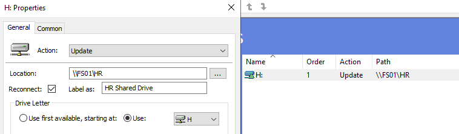

## 7. GPO Scope Verification

After creating the mapping, the policy scope was inspected.

The checks included:

- The GPO link to the HR OU.
- The enabled state of the policy and its link.
- The applicable security filtering.
- The location of the affected user account in Active Directory.

The user's organizational unit was inspected using:

```powershell
Get-ADUser anna.kowalska |
    Select-Object Name, DistinguishedName
```

This step is important because security group membership and Organizational Unit placement are not interchangeable.

A GPO linked to a specific OU must be within the user's applicable policy scope.

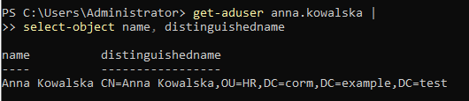

## 8. Initial Group Policy Processing

The policy was tested from CLIENT01 using the HR account:

`CORM\anna.kowalska`

Group Policy processing was refreshed:

```cmd
gpupdate /force
```

Applied user policies were inspected using:

```cmd
gpresult /scope user /r
```

The investigation focused on whether:

`GPO_HR_Map_NetworkDrive`

appeared among the applied Group Policy Objects.

This test determines whether the policy is within the user's effective GPO scope.

However, a GPO being listed as applied does not independently prove that every preference item inside it was successfully processed.

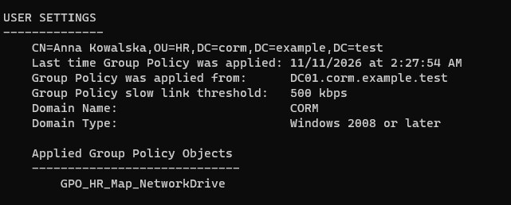

## 9. Baseline Drive Mapping Verification

After processing the GPO and signing in, the mapped network drive was verified from File Explorer.

The expected drive was:

**HR Shared Drive (H:)**

The network connection could also be inspected using:

```cmd
net use
```

The mapped drive was configured to point to:

`\\FS01\HR`

This provided a working baseline before introducing the simulated incident.

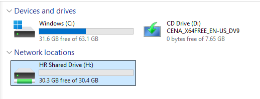

### File Access Validation

The mapped drive was opened and file operations were tested to verify access to the shared resource.

The test included creating a file within the HR directory.

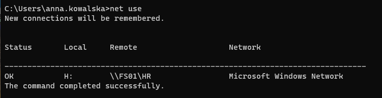

## 10. Incident Simulation

To simulate the reported incident, the Drive Maps preference item was intentionally disabled.

On DC01, the following path was opened:

**User Configuration → Preferences → Windows Settings → Drive Maps**

The configured H: mapping item was disabled.

Importantly, the entire Group Policy Object was not disabled.

The GPO remained linked to the HR OU.

This created a scenario in which the policy itself could remain applicable while its drive mapping preference item no longer performed the expected action.

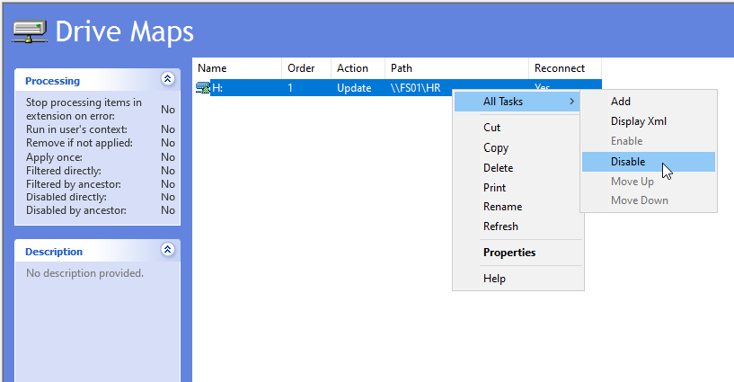

## 11. Reproducing the Missing Drive

The existing drive mapping was removed on CLIENT01:

```cmd
net use H: /delete /y
```

Removing the existing mapping was necessary because disabling a Group Policy Preference item does not necessarily remove a drive that was already created.

The Group Policy refresh command was then executed:

```cmd
gpupdate /force
```

The user session was refreshed through sign-out and sign-in.

The mapped drive was checked using:

```cmd
net use
```

The expected H: mapping was missing, reproducing the simulated incident.

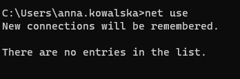

## 12. Network and SMB Diagnostics

The next step was to determine whether the missing mapping was caused by a problem reaching the File Server.

The following commands were used on CLIENT01:

```powershell
Resolve-DnsName FS01

Test-NetConnection FS01 -Port 445

Test-Path "\\FS01\HR"
```

### Diagnostic Purpose

**Resolve-DnsName**

Checks whether the File Server hostname can be resolved through DNS.

**Test-NetConnection**

Checks whether the SMB service is reachable on TCP port 445.

**Test-Path**

Tests whether the shared resource can be accessed through the specified UNC path in the current user context.

These checks help distinguish a connectivity or share-access problem from a Group Policy drive mapping problem.

Successful network connectivity alone does not guarantee access permissions or successful drive mapping.

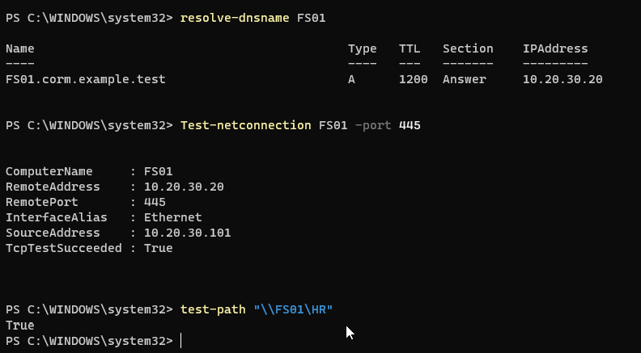

## 13. Group Policy Diagnostics

The investigation continued by checking the user identity and applied Group Policy Objects.

On CLIENT01:

```cmd
whoami

gpresult /scope user /r
```

The purpose was to determine whether the affected domain user was receiving the expected policy.

An additional HTML report was generated:

```powershell
New-Item -Path "C:\Temp" -ItemType Directory -Force

gpresult /scope user /h "C:\Temp\HD006-GPO-Report.html" /f
```

### Diagnostic Interpretation

A GPO may appear in the list of applied policies even when one of its individual preference items is disabled.

Therefore, the presence of the GPO in `gpresult` must be evaluated alongside the settings configured in Group Policy Management.

The report provides information about policy processing and scope, but it does not automatically establish that the network drive was successfully created.

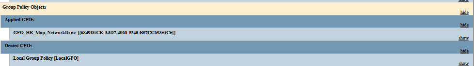

## 14. Windows Event Viewer Analysis

Windows Event Viewer was used to inspect Group Policy processing.

The following log was reviewed:

**Applications and Services Logs → Microsoft → Windows → GroupPolicy → Operational**

An informational Group Policy event was observed:

**Event ID 4016 — GroupPolicy**

The displayed event described the start of Security Extension Processing.

It also indicated that changes had been detected in applicable Group Policy Objects.

### Interpretation

Event ID 4016 demonstrates that Windows initiated processing for a Group Policy client-side extension.

However, this particular event concerned Security Extension Processing and did not independently identify the missing drive mapping or the disabled Drive Maps item.

The event was therefore treated as supporting diagnostic information, not as the root cause of the incident.

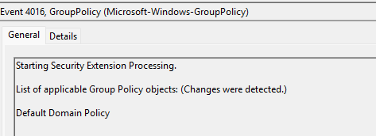

## 15. Root Cause Analysis

**Root Cause: Disabled Group Policy Preference Drive Maps Item**

The investigation returned to the Group Policy Management Editor on DC01.

The configuration of:

`GPO_HR_Map_NetworkDrive`

was reviewed.

The individual mapped drive preference item had been disabled.

The GPO itself remained linked to the HR organizational unit.

### Technical Explanation

Group Policy Preferences allow administrators to configure individual preference items within a GPO.

An individual preference item can be disabled without disabling the entire GPO.

When the Drive Maps item is disabled, its mapping action is not processed.

Therefore, the GPO may still appear as applied while the expected network drive is not created.

The incident was caused by an intentionally introduced configuration change rather than a confirmed file server outage or NTFS permission failure.

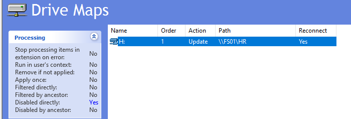

## 16. Resolution

The disabled preference item was re-enabled in the Group Policy Management Editor.

The settings were reviewed:

| Setting | Value |
|---|---|
| Preference Item | Enabled |
| Action | Update |
| Location | \\FS01\HR |
| Drive Letter | H: |
| Label | HR Shared Drive |

The repair restored the intended drive mapping configuration without changing the existing SMB or NTFS permissions.

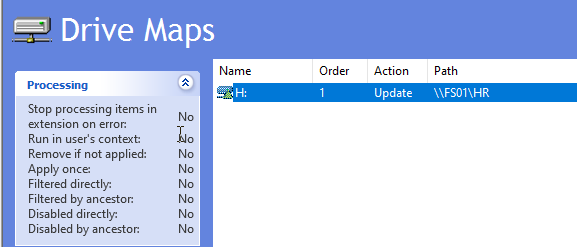

## 17. Final Validation

After restoring the preference item, the affected user refreshed Group Policy:

```cmd
gpupdate /force
```

The user then signed out and signed back in.

The network connections were checked:

```cmd
net use
```

The mapped H: drive was restored.

The HR shared folder was accessible again through the mapped drive letter.

This confirmed that the corrected Group Policy Preference configuration restored the expected functionality.

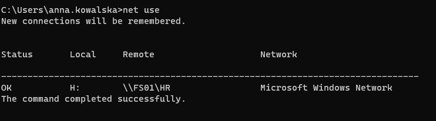

**Final Ticket Status: Resolved**

## 18. Lessons Learned

### Group Policy Objects vs Group Policy Preferences

An applied GPO does not guarantee that every individual preference item inside it is enabled or functioning as intended.

### User Configuration Scope

Policies configured under User Configuration are generally processed according to the user's applicable Active Directory policy scope.

### Existing Drive Mappings

Previously mapped drives may remain available even after a preference item is disabled.

Removing an existing mapping can be necessary when reproducing a failure involving automatic drive creation.

### Structured Troubleshooting

Network drive issues should be investigated systematically by separating:

- DNS resolution
- SMB connectivity
- User authentication
- Share permissions
- GPO scope
- Preference item configuration
- Client-side policy processing

### Event Viewer Interpretation

Informational Group Policy events should not automatically be classified as errors.

Event details must be correlated with the reported symptoms and the actual configuration.

### Root Cause vs Symptom

The missing H: drive was the symptom.

The disabled Drive Maps preference item was the configuration-level root cause.

## 19. Skills Demonstrated

- Active Directory administration
- Group Policy Management
- Group Policy Preferences
- Automatic network drive deployment
- Windows Server administration
- SMB connectivity troubleshooting
- Windows client support
- PowerShell diagnostics
- GPResult analysis
- Windows Event Viewer investigation
- Root cause identification
- Troubleshooting and remediation
- Technical documentation

---

## Disclaimer

This project was performed in an isolated home laboratory using fictional employee accounts and virtual machines.

The incident was intentionally simulated for educational purposes.

It does not represent a real production incident or paid corporate administration experience.

---

**GitHub:** [NikoBialkow](https://github.com/NikoBialkow)

**Focus:** IT Support | Active Directory | Windows Server | Troubleshooting
